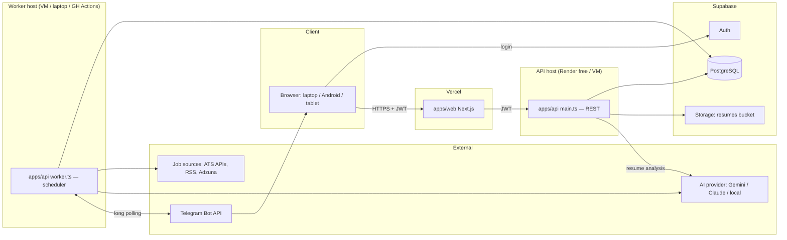
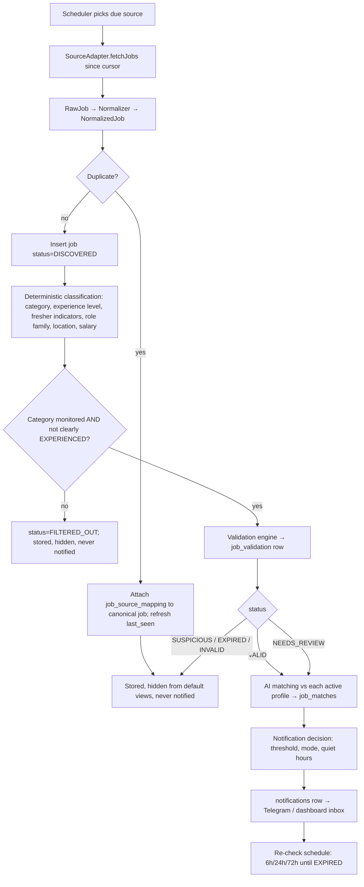
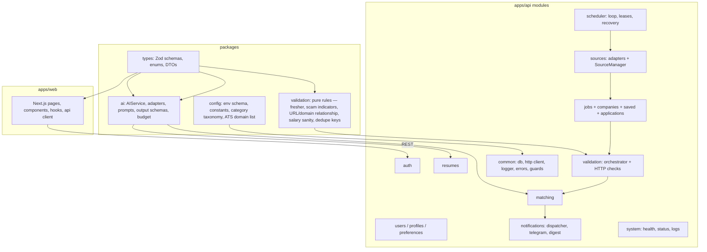

# 01 — Final Architecture & Component Architecture

## 1. System context

JobSentinel AI is three deployable units sharing one database and one set of TypeScript packages:

| Unit                                 | Runtime                              | Responsibility                                                                                                                                                   | Talks to                                                                  |
| ------------------------------------ | ------------------------------------ | ---------------------------------------------------------------------------------------------------------------------------------------------------------------- | ------------------------------------------------------------------------- |
| **web** (`apps/web`)                 | Next.js (App Router), browser        | Onboarding, dashboard, job browsing, tracker, preferences, system status                                                                                         | Supabase Auth (login only), API (`/api/v1/*`)                             |
| **api** (`apps/api`, `main.ts`)      | NestJS HTTP server                   | Authenticated REST API, resume upload/parsing, preferences, reads of jobs/matches, manual actions (save, apply, trigger scan)                                    | Postgres (Supabase), Supabase Storage, AI provider (resume analysis only) |
| **worker** (`apps/api`, `worker.ts`) | NestJS application context (no HTTP) | Scheduler loop, source scanning, normalization, dedupe, validation, fresher classification, AI matching, notification dispatch, re-checks, Telegram long-polling | Postgres, job sources (HTTP), AI provider, Telegram Bot API               |

**Why API and worker are separate processes but one codebase:** the API must answer HTTP quickly and can sleep on a free host; the worker must run continuously (or on a cron) and must never be blocked by HTTP traffic. Both import the same Nest modules, so business logic exists once. See doc 05 for the module map and doc 14 for host portability.

## 2. Pipeline (the heart of the system)

Every job flows through a fixed set of stages. Each stage is idempotent, records its outcome on the job row, and can be re-run without side effects. The pipeline is **pull-based**: the worker selects jobs by `status` rather than pushing messages, which is what makes crash recovery trivial (doc 07).

## 3. Component map

### Package responsibilities

| Package               | Contains                                                                                                                                                                                                                                     | Must not contain                                                   |
| --------------------- | -------------------------------------------------------------------------------------------------------------------------------------------------------------------------------------------------------------------------------------------- | ------------------------------------------------------------------ |
| `packages/types`      | Zod schemas for every domain object (`NormalizedJob`, `ResumeProfile`, `ValidationResult`, `MatchResult`, API DTOs), enums (`JobStatus`, `ExperienceLevel`, `JobCategory`, …), inferred TS types                                             | Runtime I/O, Nest decorators                                       |
| `packages/validation` | Pure functions: `classifyExperience()`, `detectSuspiciousIndicators()`, `domainRelationship()`, `computeDedupeKeys()`, `simhash()`, `normalizeTitle()`, `normalizeCompany()`, `extractSalary()`, `classifyCategory()`, `normalizeLocation()` | Network calls, DB access                                           |
| `packages/ai`         | `AIService` façade, `AIProvider` interface, `GeminiAdapter`, `ClaudeAdapter`, `LocalModelAdapter`, prompt templates (versioned), output Zod schemas, JSON repair, retry/backoff, token/call accounting hooks                                 | Business decisions (it returns structured signals; callers decide) |
| `packages/config`     | `envSchema` (Zod), typed `loadEnv()`, taxonomy constants (role families, categories, ATS domains, positive/negative fresher indicators, salary bands), scan intervals                                                                        | Secrets                                                            |

### Backend module responsibilities (summary — full detail in doc 05)

| Module          | Owns tables                                                                            | Public services                                                                                                             |
| --------------- | -------------------------------------------------------------------------------------- | --------------------------------------------------------------------------------------------------------------------------- |
| `auth`          | —                                                                                      | `SupabaseJwtGuard`, `CurrentUser` decorator, first-login user bootstrap                                                     |
| `users`         | `users`, `profiles`, `profile_skills`, `skills`, `preferred_roles`, `preferences`      | `ProfilesService`, `PreferencesService`                                                                                     |
| `resumes`       | `resumes`                                                                              | `ResumesService` (upload → parse → analyze → propose profile)                                                               |
| `jobs`          | `jobs`, `companies`, `job_source_mappings`, `saved_jobs`, `applications`, `job_events` | `JobsService`, `CompaniesService`, `DedupeService`, `TrackerService`                                                        |
| `sources`       | `job_sources`, `scan_runs`                                                             | `SourceRegistry`, `SourceManager`, adapters                                                                                 |
| `scheduler`     | — (uses `job_sources.next_scan_at`, `jobs.status`)                                     | `SchedulerService`, `WorkerLoop`, `RecoveryService`                                                                         |
| `validation`    | `job_validation`                                                                       | `ValidationOrchestrator`, `UrlProbeService`, `CompanyVerificationService`, `AvailabilityService`                            |
| `matching`      | `job_matches`                                                                          | `MatchingService`, `PriorityService`                                                                                        |
| `notifications` | `notifications`, `notification_settings`, `telegram_links`                             | `NotificationDispatcher`, `TelegramService`, `DigestService`                                                                |
| `system`        | `system_logs`, `ai_calls`                                                              | `HealthController`, `StatusService`, `AuditLogger`                                                                          |
| `common`        | —                                                                                      | `DbModule` (Drizzle), `HttpClient` (timeouts, retries, rate limits, UA), `Logger` (pino), `AppError`, interceptors, filters |

## 4. Key runtime sequences

### 4.1 Onboarding

1. User signs up (Supabase Auth, browser) → receives JWT.
2. First API call with that JWT → `auth` bootstraps `users` + `preferences` + `notification_settings` rows (idempotent).
3. `POST /resumes` (multipart) → API validates file → stores in private bucket → extracts text synchronously (small files) → inserts `resumes(parse_status=PARSED)`.
4. `POST /resumes/:id/analyze` → `AIService.extractResumeProfile()` → Zod-validated `ResumeProfileDraft` stored on `resumes.ai_analysis`.
5. UI shows draft (skills, roles, graduation year, locations) → user edits → `PUT /profile` + `PUT /preferences` → `profile_version` increments → monitoring becomes active for that user.

### 4.2 Scan tick (worker)

1. `SchedulerService.tick()` leases up to N due sources (`next_scan_at <= now()`, `enabled`, `status != DISABLED`) using `FOR UPDATE SKIP LOCKED`, sets `lease_until`.
2. For each source (bounded concurrency, isolated try/catch): create `scan_runs(status=RUNNING)`; call `adapter.fetchJobs({ since: last_successful_scan, cursor: last_cursor })`.
3. For each raw job: normalize → dedupe → upsert → enqueue pipeline stages by setting `status`.
4. On success: `scan_runs.completed`, `job_sources.last_successful_scan = scan_started_at`, `next_scan_at = now() + interval(priority)`, `consecutive_failures = 0`.
5. On failure: `scan_runs.FAILED`, `last_error`, `consecutive_failures++`, `next_scan_at = now() + backoff(consecutive_failures)`; the **cursor is not advanced**, so the next successful run re-covers the gap.

### 4.3 Post-scan pipeline (worker, same tick or later)

`PipelineService.drain()` processes jobs in status order with small batches: `DISCOVERED → CLASSIFIED → VALIDATING → VALID|… → MATCHED → NOTIFY_PENDING → NOTIFIED`. Each stage has its own bounded batch and error isolation; a job that throws is marked `stage_error` with a retry counter and does not stop the batch.

### 4.4 Dashboard read

`GET /jobs?...` hits indexed columns only (`status`, `fresher_eligible`, `category`, `first_seen_at`, `match_score`) and returns cursor-paginated results with the per-user match and tracker state joined in.

## 5. Cross-cutting concerns

- **Idempotency:** every write in the pipeline is an upsert keyed by a natural key (`(source_id, external_id)`, `(job_id, user_id, profile_version)`, `(user_id, job_id, channel, type)`).
- **Error isolation:** source-level, job-level and stage-level try/catch; failures are recorded on the row and logged; nothing propagates to the loop.
- **Observability:** structured pino logs; `system_logs` table for important business events (job discovered, validated, notified, source failed); `/health` and `/system/status` endpoints; latency fields `posted_at → first_seen_at → validated_at → notified_at` on each job.
- **Configuration:** one Zod-validated env schema (`packages/config`), fail-fast on boot.
- **Provider independence:** AI (`AIProvider`), scheduler (`SchedulerPort`), storage (`FileStoragePort`), notifications (`NotificationChannel`) are all interfaces with one default implementation each.
