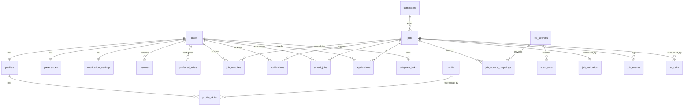

# 02 — Database Design (Supabase PostgreSQL)

Conventions: `snake_case`, `uuid` primary keys (`gen_random_uuid()`), `timestamptz` everywhere (UTC), `created_at`/`updated_at` on every table (trigger-maintained), Postgres enums for closed sets, `jsonb` only for genuinely semi-structured data (raw payloads, evidence lists). Migrations are SQL files managed by drizzle-kit and committed to git. Schema is `public`; auth users live in Supabase's `auth.users`.

## 1. ER diagram



## 2. Enums

```sql
CREATE TYPE experience_level AS ENUM ('FRESHER','ENTRY_LEVEL','EXPERIENCED','UNKNOWN');
CREATE TYPE job_category AS ENUM ('SOFTWARE','IT_SUPPORT','NETWORK','CLOUD_DEVOPS','DATA',
  'ELECTRICAL_ELECTRONICS','MECHANICAL','CIVIL','OTHER_ENGINEERING','NON_ENGINEERING','UNKNOWN');
CREATE TYPE employment_type AS ENUM ('FULL_TIME','PART_TIME','INTERNSHIP','CONTRACT','TRAINEE','UNKNOWN');
CREATE TYPE job_status AS ENUM ('DISCOVERED','CLASSIFIED','FILTERED_OUT','VALIDATING','VALID',
  'SUSPICIOUS','NEEDS_REVIEW','EXPIRED','REJECTED','MATCHED','AI_PENDING','NOTIFY_PENDING','NOTIFIED');
CREATE TYPE validation_status AS ENUM ('VALID','SUSPICIOUS','EXPIRED','INVALID','NEEDS_REVIEW','PENDING');
CREATE TYPE url_status AS ENUM ('OK','REDIRECTED','NOT_FOUND','CLOSED','BLOCKED','TIMEOUT','ERROR','UNCHECKED');
CREATE TYPE source_type AS ENUM ('ATS_API','PUBLIC_API','RSS','CAREER_PAGE');
CREATE TYPE source_priority AS ENUM ('HIGH','NORMAL','LOW');
CREATE TYPE source_status AS ENUM ('ACTIVE','DEGRADED','FAILING','DISABLED');
CREATE TYPE scan_status AS ENUM ('RUNNING','SUCCEEDED','FAILED','TIMED_OUT');
CREATE TYPE scan_trigger AS ENUM ('SCHEDULED','MANUAL','RECOVERY');
CREATE TYPE priority_band AS ENUM ('VERY_HIGH','HIGH','MEDIUM','OTHER');
CREATE TYPE application_status AS ENUM ('VIEWED','APPLIED','INTERVIEW','SELECTED','REJECTED','NOT_INTERESTED');
CREATE TYPE notification_channel AS ENUM ('TELEGRAM','WEB');
CREATE TYPE notification_type AS ENUM ('INSTANT','DIGEST','SYSTEM','TEST');
CREATE TYPE notification_status AS ENUM ('PENDING','SENT','FAILED','SKIPPED');
CREATE TYPE notification_mode AS ENUM ('INSTANT','DIGEST','BOTH','DISABLED');
CREATE TYPE remote_preference AS ENUM ('ANY','REMOTE_ONLY','ONSITE_ONLY','HYBRID_OK');
CREATE TYPE resume_parse_status AS ENUM ('UPLOADED','PARSED','ANALYZED','FAILED');
CREATE TYPE company_verification AS ENUM ('UNVERIFIED','VERIFIED','SUSPICIOUS','BLOCKED');
CREATE TYPE log_level AS ENUM ('DEBUG','INFO','WARN','ERROR');
```

## 3. Tables

### 3.1 Identity & profile

**users** — mirrors `auth.users`; created on first authenticated request.

| column                  | type                  | notes                                                    |
| ----------------------- | --------------------- | -------------------------------------------------------- |
| id                      | uuid PK               | equals `auth.users.id`                                   |
| email                   | text unique not null  |                                                          |
| display_name            | text                  |                                                          |
| is_admin                | boolean default false | can edit sources, view system logs                       |
| onboarding_completed_at | timestamptz           | null until profile confirmed                             |
| profile_version         | int default 0         | bumped on profile/preferences change; keys `job_matches` |
| created_at / updated_at | timestamptz           |                                                          |

**profiles** (1:1 with users) — the confirmed, structured job profile.

| column                  | type                 | notes                                                          |
| ----------------------- | -------------------- | -------------------------------------------------------------- |
| id                      | uuid PK              |                                                                |
| user_id                 | uuid unique FK users | cascade delete                                                 |
| source_resume_id        | uuid FK resumes      | resume this profile was derived from                           |
| experience_level        | experience_level     | usually FRESHER                                                |
| graduation_year         | smallint             |                                                                |
| degree, branch, college | text                 |                                                                |
| location_text           | text                 | home location                                                  |
| summary                 | text                 | 2–3 line AI summary, user-editable                             |
| education               | jsonb                | `[{institution, degree, field, start, end, score}]`            |
| projects                | jsonb                | `[{name, description, skills[]}]`                              |
| experience              | jsonb                | internships/work `[{company, title, start, end, description}]` |
| certifications          | jsonb                | `[{name, issuer, year}]`                                       |
| confirmed_at            | timestamptz          |                                                                |

**skills** — global normalized skill dictionary.

| column          | type        | notes                                                                             |
| --------------- | ----------- | --------------------------------------------------------------------------------- |
| id              | uuid PK     |                                                                                   |
| name            | text        | display, e.g. "PostgreSQL"                                                        |
| normalized_name | text unique | lowercase, e.g. `postgresql`                                                      |
| category        | text        | LANGUAGE, FRAMEWORK, DATABASE, CLOUD, NETWORKING, OS, DEVOPS, DATA_AI, TOOL, SOFT |
| aliases         | text[]      | `{postgres, psql}` — used by matcher                                              |

**profile_skills** — PK (`profile_id`, `skill_id`); `proficiency` (BASIC/INTERMEDIATE/ADVANCED/null), `origin` (RESUME|USER).

**preferred_roles**

| column                             | type    | notes                                                                        |
| ---------------------------------- | ------- | ---------------------------------------------------------------------------- |
| id                                 | uuid PK |                                                                              |
| user_id                            | uuid FK |                                                                              |
| title                              | text    | as user typed                                                                |
| normalized_title                   | text    | via `normalizeTitle()`                                                       |
| role_family                        | text    | e.g. `software_engineer`, `network_engineer` (taxonomy in `packages/config`) |
| tier                               | text    | PRIMARY / SECONDARY / OTHER                                                  |
| enabled                            | boolean |                                                                              |
| unique (user_id, normalized_title) |         |                                                                              |

**preferences** (1:1 with users)

| column                     | type                        | notes                                                                           |
| -------------------------- | --------------------------- | ------------------------------------------------------------------------------- |
| user_id                    | uuid PK FK                  |                                                                                 |
| locations                  | text[]                      | `{India, Bengaluru, Remote}` — normalized                                       |
| remote_preference          | remote_preference           |                                                                                 |
| employment_types           | employment_type[]           |                                                                                 |
| categories                 | job_category[]              | monitored categories; default SOFTWARE, IT_SUPPORT, NETWORK, CLOUD_DEVOPS, DATA |
| fresher_only               | boolean default true        | if true, EXPERIENCED jobs are filtered out                                      |
| include_unknown_experience | boolean default true        | UNKNOWN experience still validated (AI decides)                                 |
| salary_min                 | int                         | optional, in `salary_currency` per year                                         |
| salary_currency            | text default 'INR'          |                                                                                 |
| graduation_year            | smallint                    | copied from profile, editable                                                   |
| timezone                   | text default 'Asia/Kolkata' |                                                                                 |
| instant_min_score          | smallint default 75         | threshold for instant alerts                                                    |

### 3.2 Resumes

**resumes**

| column                                | type                | notes                                              |
| ------------------------------------- | ------------------- | -------------------------------------------------- |
| id                                    | uuid PK             |                                                    |
| user_id                               | uuid FK             |                                                    |
| storage_path                          | text                | private bucket `resumes/{user_id}/{id}.pdf`        |
| file_name, mime_type                  | text                |                                                    |
| size_bytes                            | int                 | ≤ 5 MB enforced                                    |
| sha256                                | text                | dedupe re-uploads                                  |
| parse_status                          | resume_parse_status |                                                    |
| extracted_text                        | text                | plain text; never sent to logs                     |
| ai_analysis                           | jsonb               | `ResumeProfileDraft` (Zod-validated)               |
| ai_provider, ai_model, prompt_version | text                | provenance                                         |
| is_active                             | boolean             | exactly one active per user (partial unique index) |
| error_message                         | text                |                                                    |
| uploaded_at, parsed_at, analyzed_at   | timestamptz         |                                                    |

### 3.3 Sources & scans

**job_sources**

| column                                    | type                   | notes                                                                                                     |
| ----------------------------------------- | ---------------------- | --------------------------------------------------------------------------------------------------------- |
| id                                        | uuid PK                |                                                                                                           |
| name                                      | text unique            | e.g. "Greenhouse: Razorpay"                                                                               |
| type                                      | source_type            |                                                                                                           |
| adapter                                   | text                   | `greenhouse`, `lever`, `ashby`, `smartrecruiters`, `workable`, `remotive`, `rss`, `adzuna`, `career_page` |
| base_url                                  | text                   |                                                                                                           |
| config                                    | jsonb                  | adapter-specific (`{boardToken:"razorpay"}`, `{feedUrl:…}`, `{country:"in", what:"graduate engineer"}`)   |
| company_id                                | uuid FK companies null | for single-company sources                                                                                |
| enabled                                   | boolean                |                                                                                                           |
| priority                                  | source_priority        | HIGH 10 min, NORMAL 30 min, LOW 60 min                                                                    |
| scan_interval_sec                         | int                    | overrides priority default                                                                                |
| min_request_gap_ms                        | int default 1000       | per-source politeness                                                                                     |
| next_scan_at                              | timestamptz            | scheduler key                                                                                             |
| lease_until                               | timestamptz            | worker lease                                                                                              |
| last_attempted_scan, last_successful_scan | timestamptz            |                                                                                                           |
| last_cursor                               | text                   | adapter-defined (`updated_after`, page token, last item GUID)                                             |
| last_seen_external_id                     | text                   |                                                                                                           |
| last_error                                | text                   |                                                                                                           |
| consecutive_failures                      | int                    |                                                                                                           |
| status                                    | source_status          | derived: ACTIVE / DEGRADED (1–2 failures) / FAILING (≥3) / DISABLED                                       |
| robots_checked_at, robots_allowed         | timestamptz, boolean   | for CAREER_PAGE                                                                                           |
| created_at / updated_at                   |                        |                                                                                                           |

**scan_runs**

| column                                           | type         | notes                          |
| ------------------------------------------------ | ------------ | ------------------------------ |
| id                                               | uuid PK      |                                |
| source_id                                        | uuid FK      |                                |
| trigger                                          | scan_trigger |                                |
| started_at, completed_at                         | timestamptz  |                                |
| status                                           | scan_status  |                                |
| window_from, window_to                           | timestamptz  | what the scan claimed to cover |
| jobs_found, jobs_new, jobs_updated, jobs_skipped | int          |                                |
| requests_made                                    | int          |                                |
| error_message                                    | text         |                                |
| duration_ms                                      | int          |                                |

### 3.4 Companies & jobs

**companies**

| column                  | type                 | notes                                   |
| ----------------------- | -------------------- | --------------------------------------- |
| id                      | uuid PK              |                                         |
| name                    | text                 |                                         |
| normalized_name         | text unique          |                                         |
| website_domain          | text                 | registrable domain, e.g. `razorpay.com` |
| careers_url             | text                 |                                         |
| ats_provider, ats_slug  | text                 | e.g. `greenhouse`, `razorpay`           |
| verification_status     | company_verification |                                         |
| verification_confidence | numeric(3,2)         | 0–1                                     |
| verification_evidence   | jsonb                | `[{check, result, detail, at}]`         |
| is_trusted              | boolean              | user-marked                             |
| is_blocked              | boolean              | user-marked; jobs auto-REJECTED         |
| verified_at             | timestamptz          |                                         |
| sources_count           | int                  | independent sources seen                |

**jobs** — canonical job (one row per real-world posting)

| column                                                                           | type                 | notes                            |
| -------------------------------------------------------------------------------- | -------------------- | -------------------------------- |
| id                                                                               | uuid PK              |                                  |
| company_id                                                                       | uuid FK companies    |                                  |
| title                                                                            | text                 | as posted                        |
| normalized_title                                                                 | text                 |                                  |
| role_family                                                                      | text                 | taxonomy key                     |
| category                                                                         | job_category         |                                  |
| description                                                                      | text                 | cleaned plain text/markdown      |
| description_html                                                                 | text                 | sanitized original (optional)    |
| requirements                                                                     | text[]               | extracted bullets                |
| skills                                                                           | text[]               | normalized skill names           |
| location_text                                                                    | text                 | as posted                        |
| location_city, location_country                                                  | text                 | normalized                       |
| is_remote                                                                        | boolean              |                                  |
| employment_type                                                                  | employment_type      |                                  |
| experience_text                                                                  | text                 | e.g. "0-2 years"                 |
| experience_min_years, experience_max_years                                       | numeric(3,1)         |                                  |
| experience_level                                                                 | experience_level     |                                  |
| fresher_eligible                                                                 | boolean              | null = unknown                   |
| fresher_confidence                                                               | numeric(3,2)         |                                  |
| fresher_evidence                                                                 | jsonb                | matched indicators, AI verdict   |
| salary_min, salary_max                                                           | numeric              |                                  |
| salary_currency, salary_period, salary_text                                      | text                 |                                  |
| posted_at                                                                        | timestamptz          | from source, may be null         |
| first_seen_at                                                                    | timestamptz not null |                                  |
| last_seen_at                                                                     | timestamptz          | last time any source listed it   |
| deadline                                                                         | timestamptz          |                                  |
| source_url                                                                       | text                 | canonical listing page           |
| application_url                                                                  | text                 | as discovered                    |
| final_application_url                                                            | text                 | after redirects                  |
| dedupe_key                                                                       | text                 | `sha1(company_norm               | title_norm | location_norm)` |
| description_simhash                                                              | bigint               |                                  |
| content_hash                                                                     | text                 | to detect updates                |
| validation_status                                                                | validation_status    | denormalized from job_validation |
| validation_confidence                                                            | numeric(3,2)         |                                  |
| status                                                                           | job_status           | lifecycle                        |
| stage_error                                                                      | text                 | last pipeline error              |
| stage_attempts                                                                   | int                  |                                  |
| validated_at, matched_at, notified_at, closed_at, last_checked_at, next_check_at | timestamptz          | latency + re-check               |
| created_at / updated_at                                                          |                      |                                  |

**job_source_mappings** — a job as seen by one source.

| column                          | type                | notes                                        |
| ------------------------------- | ------------------- | -------------------------------------------- |
| id                              | uuid PK             |                                              |
| job_id                          | uuid FK jobs        |                                              |
| source_id                       | uuid FK job_sources |                                              |
| external_id                     | text                | source's own id                              |
| source_url                      | text                |                                              |
| raw_payload                     | jsonb               | original record (bounded to 64 KB)           |
| is_primary                      | boolean             | the mapping that populated the canonical row |
| first_seen_at, last_seen_at     | timestamptz         |                                              |
| unique (source_id, external_id) |                     | idempotent upsert key                        |

**job_validation** (1:1 with jobs)

| column                      | type              | notes                                                     |
| --------------------------- | ----------------- | --------------------------------------------------------- |
| job_id                      | uuid PK FK        |                                                           |
| status                      | validation_status |                                                           |
| confidence                  | numeric(3,2)      |                                                           |
| company_verified            | boolean           |                                                           |
| application_verified        | boolean           |                                                           |
| job_active                  | boolean           |                                                           |
| fresher_eligible            | boolean           |                                                           |
| original_url, final_url     | text              |                                                           |
| http_status                 | smallint          |                                                           |
| redirect_chain              | jsonb             | `[{url, status}]`                                         |
| url_status                  | url_status        |                                                           |
| url_domain_relationship     | text              | SAME_DOMAIN / KNOWN_ATS / SUBDOMAIN / UNRELATED / UNKNOWN |
| suspicious_flags            | text[]            | codes from `packages/validation`                          |
| evidence                    | jsonb             | `[{check, passed, weight, detail}]`                       |
| ai_assessment               | jsonb             | optional `{verdict, reasons[], confidence}`               |
| review_note                 | text              | user's manual decision reason                             |
| reviewed_by_user_at         | timestamptz       |                                                           |
| attempts                    | int               |                                                           |
| validated_at, next_check_at | timestamptz       |                                                           |

**job_matches**

| column                                                                   | type             | notes                                |
| ------------------------------------------------------------------------ | ---------------- | ------------------------------------ |
| id                                                                       | uuid PK          |                                      |
| job_id, user_id                                                          | uuid FK          |                                      |
| profile_version                                                          | int              |                                      |
| overall_score, skill_score, role_score, experience_score, location_score | smallint (0–100) |                                      |
| priority                                                                 | priority_band    |                                      |
| matched_skills, missing_skills                                           | text[]           |                                      |
| explanation                                                              | text             | human-readable                       |
| ai_provider, ai_model, prompt_version                                    | text             | null when computed deterministically |
| computed_at                                                              | timestamptz      |                                      |
| unique (job_id, user_id, profile_version)                                |                  |                                      |

### 3.5 User interaction

**saved_jobs** — PK (`user_id`, `job_id`), `created_at`, `note`.

**applications**

| column          | type               | notes            |
| --------------- | ------------------ | ---------------- |
| id              | uuid PK            |                  |
| user_id, job_id | uuid FK            | unique pair      |
| status          | application_status |                  |
| applied_at      | timestamptz        |                  |
| notes           | text               |                  |
| history         | jsonb              | `[{status, at}]` |

**job_events** — per-job audit trail: `id`, `job_id`, `type` (DISCOVERED, DEDUPED, CLASSIFIED, VALIDATED, MATCHED, NOTIFIED, RECHECKED, EXPIRED, USER_REVIEWED, …), `detail jsonb`, `created_at`.

### 3.6 Notifications

**notification_settings** (1:1 with users)

| column                         | type                             |
| ------------------------------ | -------------------------------- |
| user_id                        | uuid PK                          |
| mode                           | notification_mode default 'BOTH' |
| digest_hour_local              | smallint default 8               |
| quiet_hours                    | int4range null (local hours)     |
| instant_min_score              | smallint default 75              |
| include_needs_review_in_digest | boolean default true             |
| telegram_enabled               | boolean                          |

**telegram_links** — `user_id PK`, `chat_id bigint unique`, `telegram_username`, `link_code text unique`, `link_code_expires_at`, `linked_at`.

**notifications**

| column                                                               | type                 | notes                      |
| -------------------------------------------------------------------- | -------------------- | -------------------------- |
| id                                                                   | uuid PK              |                            |
| user_id                                                              | uuid FK              |                            |
| job_id                                                               | uuid FK null         | null for digest/system     |
| channel                                                              | notification_channel |                            |
| type                                                                 | notification_type    |                            |
| status                                                               | notification_status  |                            |
| payload                                                              | jsonb                | rendered message + buttons |
| digest_date                                                          | date null            | for DIGEST                 |
| attempts                                                             | int                  |                            |
| error                                                                | text                 |                            |
| read_at                                                              | timestamptz          | WEB inbox                  |
| sent_at, created_at                                                  | timestamptz          |                            |
| **unique** (user_id, job_id, channel, type) where job_id is not null |                      | **never notify twice**     |
| **unique** (user_id, channel, digest_date) where type = 'DIGEST'     |                      | one digest per day         |

### 3.7 System

**system_logs** — `id`, `level log_level`, `category` (SCAN, PIPELINE, VALIDATION, AI, NOTIFY, AUTH, API), `message`, `context jsonb`, `source_id`, `job_id`, `user_id`, `created_at`. Retention: 30 days (worker cleanup task).

**ai_calls** — `id`, `provider`, `model`, `purpose` (RESUME_PROFILE, FRESHER_CLASSIFY, JOB_REQUIREMENTS, MATCH, SUSPICION), `input_hash` (cache key), `input_tokens`, `output_tokens`, `latency_ms`, `status` (OK, INVALID_JSON, ERROR, BUDGET_EXCEEDED), `job_id`, `user_id`, `response jsonb` (cached, validated output), `created_at`. Unique on (`purpose`, `prompt_version`, `input_hash`) enables cache hits.

**worker_heartbeats** — `worker_id text PK`, `hostname`, `version`, `started_at`, `last_beat_at`, `current_task`. Powers System Status "worker alive?".

## 4. Indexes

```sql
-- jobs: dashboard filters and pipeline selection
CREATE INDEX jobs_status_idx            ON jobs (status);
CREATE INDEX jobs_first_seen_idx        ON jobs (first_seen_at DESC);
CREATE INDEX jobs_posted_idx            ON jobs (posted_at DESC NULLS LAST);
CREATE INDEX jobs_company_idx           ON jobs (company_id);
CREATE INDEX jobs_category_fresher_idx  ON jobs (category, fresher_eligible) WHERE status IN ('VALID','MATCHED','NOTIFIED','NEEDS_REVIEW');
CREATE INDEX jobs_dedupe_key_idx        ON jobs (dedupe_key);
CREATE INDEX jobs_app_url_idx           ON jobs (final_application_url);
CREATE INDEX jobs_next_check_idx        ON jobs (next_check_at) WHERE status IN ('VALID','MATCHED','NOTIFIED');
CREATE INDEX jobs_title_trgm_idx        ON jobs USING gin (normalized_title gin_trgm_ops);
CREATE INDEX jobs_location_idx          ON jobs (location_country, location_city);
CREATE INDEX jobs_search_idx            ON jobs USING gin (to_tsvector('english', coalesce(title,'') || ' ' || coalesce(description,'')));
-- matches / user views
CREATE INDEX job_matches_user_score_idx ON job_matches (user_id, overall_score DESC);
CREATE INDEX job_matches_job_idx        ON job_matches (job_id);
-- sources / scheduler
CREATE INDEX job_sources_due_idx        ON job_sources (next_scan_at) WHERE enabled = true;
CREATE INDEX scan_runs_source_idx       ON scan_runs (source_id, started_at DESC);
-- notifications
CREATE INDEX notifications_user_idx     ON notifications (user_id, created_at DESC);
CREATE INDEX notifications_pending_idx  ON notifications (status) WHERE status = 'PENDING';
-- logs
CREATE INDEX system_logs_created_idx    ON system_logs (created_at DESC);
CREATE INDEX job_events_job_idx         ON job_events (job_id, created_at DESC);
-- resumes
CREATE UNIQUE INDEX resumes_one_active  ON resumes (user_id) WHERE is_active = true;
```

Extensions: `pg_trgm`, `pgcrypto` (both available on Supabase free).

## 5. Constraints worth calling out

- `jobs.validation_status` is denormalized from `job_validation.status` by the validation service in the same transaction (read-heavy dashboard avoids a join).
- `check (overall_score between 0 and 100)` on `job_matches`; `check (confidence between 0 and 1)` on validation/company.
- `companies.is_blocked = true` ⇒ trigger-free rule enforced in `ValidationOrchestrator`: job status `REJECTED`.
- `applications.status` transitions are validated in `TrackerService` (any → NOT_INTERESTED allowed; SELECTED/REJECTED terminal unless user reopens).

## 6. Row Level Security

The API connects with the **service-role** connection string (bypasses RLS) and enforces ownership in code (`WHERE user_id = :currentUser`). RLS is still enabled on every user-owned table so that (a) the anon/authenticated Supabase keys can never read another user's data if they are ever used from the browser, and (b) a future direct-Supabase read path is safe.

```sql
ALTER TABLE profiles ENABLE ROW LEVEL SECURITY;
CREATE POLICY profiles_owner ON profiles FOR ALL
  USING (user_id = auth.uid()) WITH CHECK (user_id = auth.uid());
-- same pattern for: preferences, preferred_roles, profile_skills (via profile), resumes,
-- job_matches, notifications, notification_settings, telegram_links, saved_jobs, applications
-- shared tables (jobs, companies, job_sources, scan_runs, job_validation): SELECT for authenticated, no writes
CREATE POLICY jobs_read ON jobs FOR SELECT TO authenticated USING (true);
-- system_logs, ai_calls, worker_heartbeats: no policies → service role only
```

Storage bucket `resumes`: private; policy allows `authenticated` users to read only `resumes/{auth.uid()}/*`. The API uploads with the service key and generates short-lived signed URLs (60 s) for download.

## 7. Seed data (Phase 3)

- `skills`: ~250 canonical skills with aliases (languages, frameworks, DBs, cloud, networking, OS, DevOps, data/AI).
- `job_sources`: ~30 starter sources — Indian and remote-friendly companies on Greenhouse/Lever/Ashby, Remotive API, 2–3 RSS feeds, Adzuna (IN, disabled until key present).
- `companies`: created lazily by sources; seed only those referenced by seeded sources (with `website_domain`, `ats_provider`, `ats_slug`, `is_trusted=true`).
- Dev-only fixtures: 20 synthetic jobs covering each status, fresher class and validation outcome, for the dashboard and tests.

## 8. Retention & housekeeping (worker daily task)

| Data                                    | Rule                                                                                             |
| --------------------------------------- | ------------------------------------------------------------------------------------------------ |
| `jobs` in EXPIRED/REJECTED/FILTERED_OUT | keep 90 days, then delete with mappings/validation/events (saved/applied jobs are never deleted) |
| `scan_runs`                             | keep 30 days                                                                                     |
| `system_logs`                           | keep 30 days                                                                                     |
| `ai_calls`                              | keep 60 days (cache)                                                                             |
| `job_source_mappings.raw_payload`       | null out after 30 days for non-active jobs                                                       |
