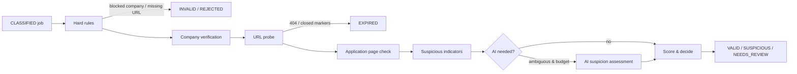

# 08 — Validation Architecture

## 1. Goal and stance

Answer, with **evidence and a confidence score**, four questions per job: Is the company real? Is the application URL genuine and alive? Is the job still open? Does anything look like a scam? Plus: is a fresher eligible (doc 09 §4 covers the AI part). The engine is **rules + evidence first**; AI contributes one weighted signal and can never flip a job to `VALID` on its own.

Outputs (`ValidationResult`, Zod-validated):

```ts
{
  status: 'VALID' | 'SUSPICIOUS' | 'EXPIRED' | 'INVALID' | 'NEEDS_REVIEW',
  confidence: number,            // 0..1
  companyVerified: boolean, applicationVerified: boolean, jobActive: boolean,
  fresherEligible: boolean | null,
  url: { original, final, httpStatus, redirectChain[], status: UrlStatus, domainRelationship },
  suspiciousFlags: string[],     // e.g. ['FEE_REQUEST', 'FREEMAIL_CONTACT']
  evidence: { check: string; passed: boolean; weight: number; detail?: string }[],
  aiAssessment?: { verdict: 'LEGIT'|'SUSPICIOUS'|'UNSURE', confidence: number, reasons: string[] }
}
```

## 2. Pipeline



## 3. Checks and evidence weights

### 3.1 Hard rules (short-circuit)

| Rule                                                                         | Result                        |
| ---------------------------------------------------------------------------- | ----------------------------- |
| `companies.is_blocked`                                                       | REJECTED                      |
| No `application_url` and no `source_url`                                     | INVALID                       |
| URL scheme not http(s), or host is an IP literal / localhost / private range | INVALID (`SSRF_GUARD`)        |
| Title empty or description < 80 chars after cleanup                          | NEEDS_REVIEW (`THIN_LISTING`) |

### 3.2 Company verification (`CompanyVerificationService`) — cached per company for 7 days

| Check                 | Evidence weight | How (free)                                                                                                                        |
| --------------------- | --------------- | --------------------------------------------------------------------------------------------------------------------------------- |
| `COMPANY_TRUSTED`     | +0.5            | user marked trusted                                                                                                               |
| `SOURCE_IS_ATS_BOARD` | +0.35           | job came from the company's own ATS board (greenhouse/lever/ashby/… with matching slug) — strongest structural evidence           |
| `DOMAIN_RESOLVES`     | +0.1            | DNS A/AAAA lookup of `website_domain`                                                                                             |
| `HOMEPAGE_REACHABLE`  | +0.1            | `HEAD/GET https://domain` 2xx/3xx, cached                                                                                         |
| `MULTI_SOURCE`        | +0.1            | company seen in ≥2 independent sources                                                                                            |
| `KNOWN_ATS_SLUG`      | +0.15           | `ats_provider/ats_slug` resolves (board exists)                                                                                   |
| `DOMAIN_LOOKALIKE`    | −0.4            | normalized company name matches a trusted/known company but domain differs (Levenshtein ≤ 2 on registrable domain, or homoglyphs) |
| `NO_DOMAIN_KNOWN`     | −0.1            | we have no website domain at all (aggregator listing)                                                                             |

`companyVerified = score ≥ 0.5`. Confidence < 0.3 → NEEDS_REVIEW unless the job's own URL evidence is strong.

### 3.3 URL probe (`UrlProbeService`)

- `GET` with 15 s timeout, follow ≤ 5 redirects manually (record chain), `Accept: text/html`, body capped 1 MB, SSRF guard on every hop (deny private IPs after DNS resolution).
- Records `http_status`, `final_url`, `url_status`:
  - 2xx → OK / REDIRECTED (if host changed)
  - 404/410 → NOT_FOUND
  - 401/403/429/challenge page → BLOCKED (not a scam signal; means we can't verify → application not verified, job stays NEEDS_REVIEW unless ATS evidence strong)
  - timeout/network → TIMEOUT/ERROR (retry ×2 over the next hour before deciding)
- `domainRelationship` (`packages/validation/domainRelationship()` using `tldts`):
  - SAME_DOMAIN: final URL registrable domain == company domain (+0.3)
  - SUBDOMAIN: `careers.acme.com` (+0.3)
  - KNOWN_ATS: host in ATS allowlist (`boards.greenhouse.io`, `jobs.lever.co`, `jobs.ashbyhq.com`, `*.myworkdayjobs.com`, `*.smartrecruiters.com`, `apply.workable.com`, `*.taleo.net`, `*.icims.com`, `*.successfactors.com`, `*.bamboohr.com`, `*.recruitee.com`, …) **and** path/subdomain contains company slug (+0.3; +0.15 without slug match)
  - UNRELATED: (−0.25) unless the source is a trusted aggregator that uses redirect links (Adzuna) — then the probe follows to the final destination first and evaluates that
  - UNKNOWN: company domain unknown (0)
- URL shorteners (`bit.ly`, `t.co`, …) in the chain → `SHORTENER_IN_CHAIN` flag (−0.15).

### 3.4 Application page check (`AvailabilityService`)

On the final page body (HTML only, ≤ 1 MB):

- **Closed markers** (case-insensitive): "no longer accepting applications", "this job is no longer available", "position has been filled", "job has been closed", "this posting has expired", ATS-specific patterns (Greenhouse "The job you are looking for is no longer open", Lever "This job is no longer accepting applications", Workday "Job is not available") → EXPIRED.
- **Application presence**: `<form>` with file input or `apply` button/link, or known ATS apply widget markers → `APPLY_FORM_PRESENT` (+0.15). Absence is neutral (many pages load forms client-side) — logged as `APPLY_FORM_UNDETECTED`.
- Source-native check where available (Greenhouse `GET /jobs/{id}` 404, Lever posting endpoint 404) — authoritative for EXPIRED.

### 3.5 Suspicious indicators (`SuspicionService`, pure rules in `packages/validation`)

| Flag                                     | Pattern (description + application page text)                                                                   | Weight              |
| ---------------------------------------- | --------------------------------------------------------------------------------------------------------------- | ------------------- |
| `FEE_REQUEST`                            | registration/training/processing fee, security deposit, "pay … to apply", "refundable amount"                   | −0.6 (near-certain) |
| `PAYMENT_APP_MENTION`                    | UPI id, Paytm/GPay/PhonePe number in a job ad                                                                   | −0.5                |
| `FREEMAIL_CONTACT`                       | contact email on gmail/yahoo/outlook/proton while company domain known                                          | −0.25               |
| `MESSAGING_APP_CONTACT`                  | "contact on WhatsApp/Telegram" + phone number                                                                   | −0.3                |
| `SENSITIVE_INFO_REQUEST`                 | Aadhaar, PAN, bank details, passport scan _before_ interview/offer                                              | −0.4                |
| `UNREALISTIC_SALARY`                     | salary > 3× the 90th percentile band for category+fresher in config (e.g. > ₹40 LPA for a fresher support role) | −0.3                |
| `URGENCY_PRESSURE`                       | "limited seats", "apply within 24 hours", "immediate joining, no interview"                                     | −0.15               |
| `NO_INTERVIEW`                           | "no interview required", "direct joining"                                                                       | −0.3                |
| `GENERIC_COMPANY`                        | company name is a generic phrase ("Leading MNC", "Reputed Company")                                             | −0.2                |
| `SHORTENER_IN_CHAIN`, `DOMAIN_LOOKALIKE` | from URL/company checks                                                                                         | as above            |
| `WORK_FROM_HOME_DATA_ENTRY`              | typical scam category tokens ("earn daily", "copy paste job")                                                   | −0.4                |

Patterns live in one versioned config file with unit tests per pattern (true positives + known false positives such as "no fee is charged by us for applying").

### 3.6 AI assessment (optional, doc 09)

Triggered only when `0.35 ≤ score ≤ 0.65` (ambiguous) **or** ≥1 suspicious flag of weight ≤ −0.25 without hard evidence. Input: title, company, trimmed description (≤ 3 k chars), flags found, URL relationship. Output Zod: `{verdict, confidence, reasons[]}`. Contribution: `LEGIT` +0.1·confidence, `SUSPICIOUS` −0.2·confidence, `UNSURE` 0. Max absolute effect 0.2 → AI cannot move a job across more than one threshold, and never from SUSPICIOUS to VALID by itself.

## 4. Decision

```
score = 0.5 (prior) + Σ evidence weights   → clamp 0..1 → confidence
if url.status in (NOT_FOUND, CLOSED) or closedMarker or sourceSays404 → EXPIRED
elif any hard-scam flag (FEE_REQUEST, PAYMENT_APP_MENTION, NO_INTERVIEW+FREEMAIL) → SUSPICIOUS
elif score >= 0.7 and companyVerified and url.status in (OK, REDIRECTED) → VALID
elif score < 0.35 → SUSPICIOUS
else → NEEDS_REVIEW
```

`applicationVerified = url.status ∈ {OK, REDIRECTED} ∧ domainRelationship ∈ {SAME_DOMAIN, SUBDOMAIN, KNOWN_ATS}`.
`jobActive = ¬EXPIRED`.

## 5. Manual review

`NEEDS_REVIEW` and `SUSPICIOUS` jobs appear in a dedicated dashboard tab with the evidence list rendered plainly ("✓ Domain resolves · ✗ Apply link on unrelated domain · ⚠ Contact is a Gmail address"). `POST /jobs/:id/review {ACCEPT|REJECT}` sets status `VALID` (with `reviewed_by_user_at`) or `REJECTED`; accepting a company-level issue offers "trust this company", which fast-tracks future jobs from it.

## 6. Re-validation

- On application URL change detected during scan.
- On re-check schedule (availability only; company/suspicion results cached).
- Manually via `/jobs/:id/revalidate`.

## 7. Explainability

Every evidence item is stored and shown. The Telegram alert lists the three strongest positives; the detail page lists everything. No "trust me" scores.
