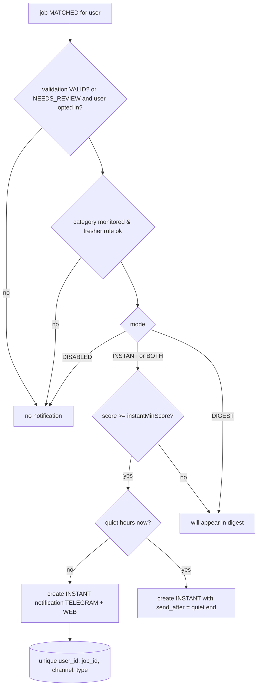

# 10 — Notification Architecture

## 1. Channels

| Channel       | Use                                                                                   | Implementation                                                       |
| ------------- | ------------------------------------------------------------------------------------- | -------------------------------------------------------------------- |
| **Telegram**  | instant alerts, daily digest, system alerts, simple commands                          | Bot API via `fetch` (no heavy framework); long polling in the worker |
| **Web inbox** | mirror of every notification + read state; the only channel when Telegram is unlinked | `notifications(channel=WEB)` rows, `InboxBell` in the app            |

`NotificationChannel` interface allows adding email/web-push later without touching the dispatcher.

## 2. Decision flow (per matched job, per user)



The unique index is the guarantee behind "never notify twice": the dispatcher inserts `ON CONFLICT DO NOTHING`, so re-matching (new profile version), re-validation or a worker restart can never create a second INSTANT for the same job. A job that was digest-only and later crosses the instant threshold (profile change) still gets only the digest mention — instant alerts are reserved for _new_ discoveries (`first_seen_at` within 48 h).

## 3. Message formats

**Instant (Telegram, HTML parse mode):**

```
🚨 <b>NEW FRESHER JOB</b> — Software Engineer
🏢 Razorpay · 📍 Bengaluru (Hybrid) · 🧑‍🎓 0–1 yrs · Fresher ✓
🎯 Match 91% — Very High
✓ Python ✓ SQL ✓ Linux ✓ Networking · ✗ Kubernetes
🛡 Company verified · Job active · Apply link verified (jobs.lever.co)
🕒 Posted 2 h ago · Deadline: 30 Sep
[ APPLY NOW ]  [ View in JobSentinel ]  [ Save ]  [ Not interested ]
```

Inline keyboard: `APPLY NOW` = URL button to `final_application_url`; `View` = dashboard deep link; `Save`/`Not interested` = callback buttons handled by the poller (idempotent via `TrackerService`).

**Daily digest:**

```
📬 JobSentinel Daily — Tue 22 Sep
🔥 Very High: 5 · 🟢 High: 12 · 🟡 Medium: 8 · ⚪ Other: 14 · 🔎 Needs review: 3
Top 5:
1. Software Engineer (Fresher) — Zoho, Chennai — 94% → /apply link
2. …
Expired since yesterday: 4 · Sources failing: 1 (Adzuna)
[ Open dashboard ]
```

Messages > 4096 chars are split; digest lists at most 15 jobs with a dashboard link for the rest.

**System alerts** (rate-limited to 1/type/6 h): worker started after > 6 h gap, source disabled after repeated failures, AI budget exhausted, Telegram link expired.

## 4. Telegram account linking (`/telegram/link`)

1. API creates `telegram_links(link_code, expires 15 min)` and returns `https://t.me/<bot>?start=<code>` + QR (rendered client-side).
2. User taps → bot receives `/start <code>` → poller looks up code → stores `chat_id`, marks linked, replies "Linked to <email masked>".
3. Only one chat per user; re-linking replaces. Messages from unknown chats are ignored (and rate-limited).

Bot commands: `/status` (worker, last scan, today's counts), `/pause 24h` / `/resume`, `/digest` (send now), `/help`. No free-text AI chat in the bot (keeps scope and budget tight).

## 5. Dispatcher

- Runs in the worker each tick: `SELECT … FROM notifications WHERE status='PENDING' AND (send_after IS NULL OR send_after <= now()) ORDER BY created_at LIMIT 50 FOR UPDATE SKIP LOCKED`.
- Telegram send: 1 msg/s global, 20/min per chat (Telegram limits); on 429 honor `retry_after`.
- Failure policy: attempts 1→5 with backoff 1 m, 5 m, 30 m, 2 h, 12 h; then `FAILED` (still visible in web inbox; `jobs.notified_at` set only when SENT on any channel).
- The WEB channel "send" is a no-op state change (row already exists), so the inbox is always complete even if Telegram is down.

## 6. Preferences (per user, `notification_settings`)

mode (INSTANT / DIGEST / BOTH / DISABLED), `instant_min_score`, `digest_hour_local`, `quiet_hours`, `include_needs_review_in_digest`, `telegram_enabled`; plus `POST /notifications/test`.

## 7. Privacy

Alerts contain job data only — never resume content. Deep links to the dashboard require login.
